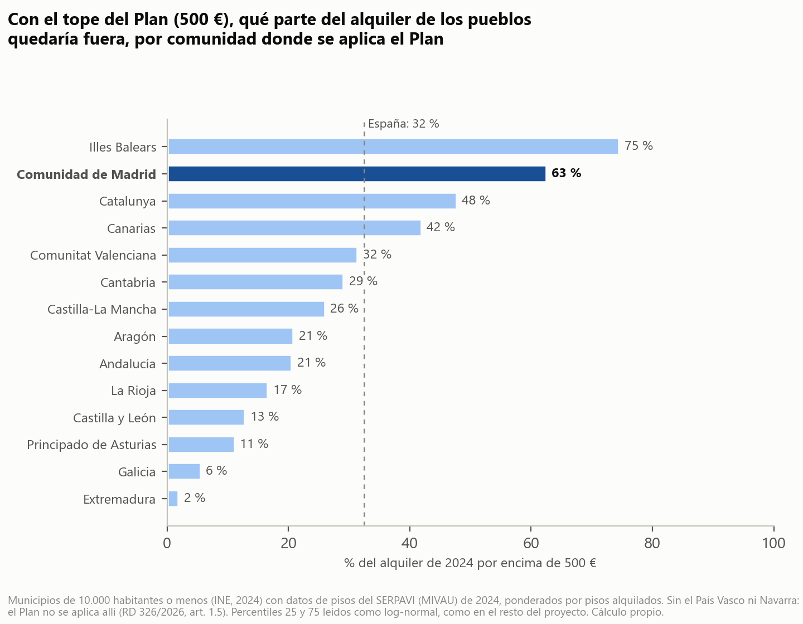

# El tope de 500 € del Plan, en toda España (exploratorio)

> Hecho con `scripts/espana_tope500.py` el 2026-11-16. Lo esperado (E1 a E5) se escribió en la cabecera del script antes de ejecutarlo, en el commit que lo añade. No está preregistrado.

## La pregunta
El Plan Estatal 2026-2030 (RD 326/2026, art. 133.1.e) pone el tope del alquiler en 500 € en los municipios de 10.000 habitantes o menos, en todas las comunidades donde se aplica: todas menos el País Vasco y Navarra (art. 1.5). En Madrid quedaría por encima el 58 % del alquiler de esos municipios (ponderado por jóvenes). ¿Pasa solo en Madrid?

## Cómo
- **Alquiler:** SERPAVI 2024 (MIVAU), pisos (vivienda colectiva), con los percentiles 25 y 75 leídos como una log-normal, igual que en el resto del proyecto (`scripts/comun.py`, `share_above`)
- **Población:** cifras oficiales del INE a 1-ene-2024 (Revisión del Padrón), una tabla por provincia, en `data/raw_2026-11-16/ine_cifras_oficiales_municipios/`
- **Pesos:** los pisos alquilados del SERPAVI, porque no tenemos los jóvenes de cada municipio de España. Por eso Madrid da aquí un 63 % y no el 58 %, que se pondera por jóvenes
- **«Más de la mitad fuera»:** solo cuenta en municipios con al menos 30 contratos en el SERPAVI, como en la base del estudio del art. 135. Con esa regla, Madrid da 33, los mismos que `data/ESTUDIO_ART135.md`

## Resultados
- **España, donde se aplica el Plan:** en los 1.590 municipios pequeños con datos del SERPAVI (de 6.883; en ellos vive el 69 % de la gente de los municipios pequeños), quedaría por encima de 500 € el 32 % del alquiler (por encima de 600 €, el 17 %)
- **En 209 municipios pequeños, donde viven 1.132.424 personas, el tope de 500 € dejaría fuera más de la mitad del alquiler**
- **Madrid es la 2.ª de las 14 comunidades con 10 municipios pequeños con datos o más** donde más alquiler de sus pueblos queda por encima: el 63 %, después de Illes Balears
- **Con el País Vasco y Navarra** (no se aplica allí el Plan): 291 municipios y 1.483.774 personas, y Madrid sería la 3.ª. Al principio los conté: lo corregí la misma noche, después de ver los resultados, cuando un jurado ciego avisó del art. 1.5

| Comunidad | Municipios pequeños | Con datos | Gente que vive en los que tienen datos | Alquiler por encima de 500 € | Por encima de 600 € (referencia) | Municipios con más de la mitad fuera | Habitantes en ellos |
|---|---|---|---|---|---|---|---|
| Illes Balears | 42 | 32 | 92 % | 75 % | 55 % | 22 | 134.587 |
| Comunidad de Madrid | 125 | 83 | 92 % | 63 % | 38 % | 33 | 205.956 |
| Catalunya | 817 | 368 | 85 % | 48 % | 28 % | 112 | 537.435 |
| Canarias | 46 | 37 | 93 % | 42 % | 20 % | 7 | 42.670 |
| Comunitat Valenciana | 437 | 199 | 85 % | 32 % | 17 % | 20 | 123.397 |
| Cantabria | 92 | 49 | 84 % | 29 % | 9 % | 0 | 0 |
| Castilla-La Mancha | 882 | 153 | 64 % | 26 % | 10 % | 7 | 40.603 |
| Aragón | 716 | 87 | 57 % | 21 % | 7 % | 1 | 4.814 |
| Andalucía | 629 | 166 | 55 % | 21 % | 11 % | 7 | 42.962 |
| La Rioja | 169 | 28 | 76 % | 17 % | 5 % | 0 | 0 |
| Castilla y León | 2.224 | 186 | 52 % | 13 % | 3 % | 0 | 0 |
| Principado de Asturias | 59 | 30 | 84 % | 11 % | 3 % | 0 | 0 |
| Galicia | 257 | 113 | 69 % | 6 % | 1 % | 0 | 0 |
| Extremadura | 375 | 51 | 44 % | 2 % | 0 % | 0 | 0 |
| Región de Murcia (menos de 10 municipios con datos: fuera del orden) | 13 | 8 | 90 % | 9 % | 3 % | 0 | 0 |
| País Vasco (fuera del Plan) | 208 | 115 | 88 % | 81 % | 50 % | 74 | 312.072 |
| Navarra (fuera del Plan) | 260 | 69 | 78 % | 37 % | 20 % | 8 | 39.278 |

## Lo esperado, frente a lo que salió
- **Ojo:** las expectativas se escribieron para «toda España». Después de ver los resultados, un jurado ciego avisó de que el Plan no se aplica en el País Vasco ni en Navarra (RD 326/2026, art. 1.5), y así es. Cada expectativa se mide con las comunidades donde se aplica el Plan, y entre paréntesis, con las 17
- **E1** (España, del 25 % al 45 %): 32 % → ✅ (con las 17: 36 %)
- **E2** (Madrid entre las 3 primeras y por encima del 50 %; las otras dos, Illes Balears y Catalunya): Madrid es la 2.ª, con el 63 % → ✅. Las tres primeras son Illes Balears, Comunidad de Madrid, Catalunya → ✅. Con las 17, las tres primeras son País Vasco, Illes Balears, Comunidad de Madrid y Madrid es la 3.ª: suponía que el SERPAVI no tenía el País Vasco ni Navarra, y sí los tiene; acierta solo porque el Plan no se aplica allí
- **E3** (Madrid, a menos de 5 puntos del 58 %): 62,6 % → ✅
- **E4** (datos en menos de la mitad de los municipios pequeños, donde vive más del 60 % de su gente): 1.590 de 6.883, con el 69 % → ✅
- **E5** (de 200 a 600 municipios con más de la mitad fuera): 209 con 30 contratos o más, y 256 sin mínimo → ✅ (con las 17: 291)

## Límites
- Los datos municipales no ven los núcleos pequeños dentro de municipios mayores, que en el Plan también tienen el tope de 500 €
- El tope de hoy no es igual en todas las comunidades (600 €, y hasta 900 € donde cada una lo decidió), así que «por encima de 600 €» es solo una referencia
- Solo pisos: las casas (vivienda unifamiliar) quedan fuera, como en el resto del proyecto
- El SERPAVI tiene datos de una cuarta parte de los municipios pequeños, pero en ellos vive la mayor parte de su gente. Los que no tienen datos suelen ser los más pequeños
- Solo mide el alquiler frente al tope: no dice nada de las solicitudes ni de los jóvenes de otras comunidades
